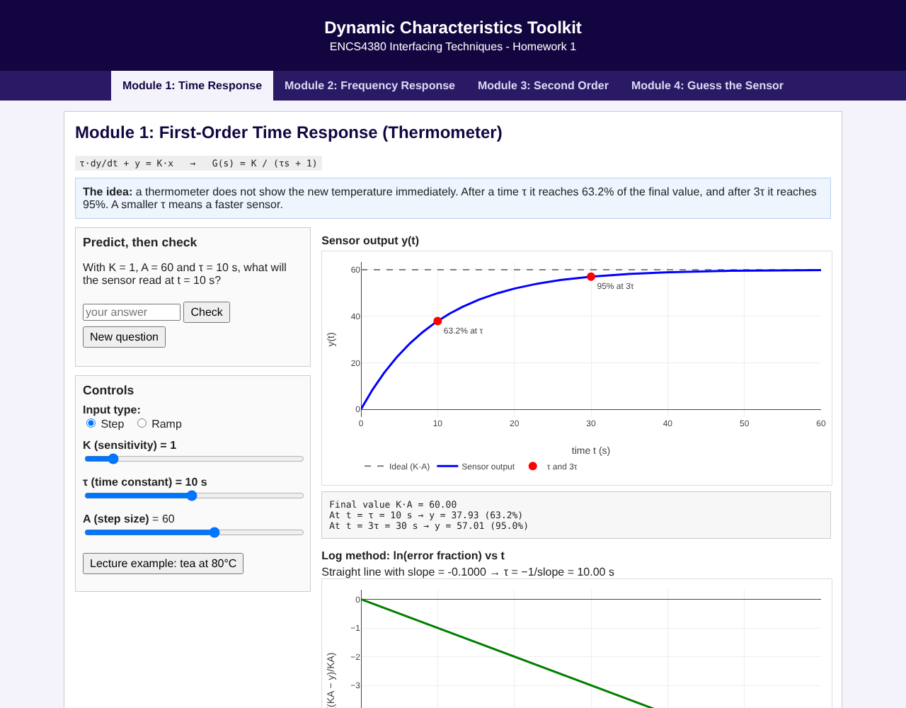
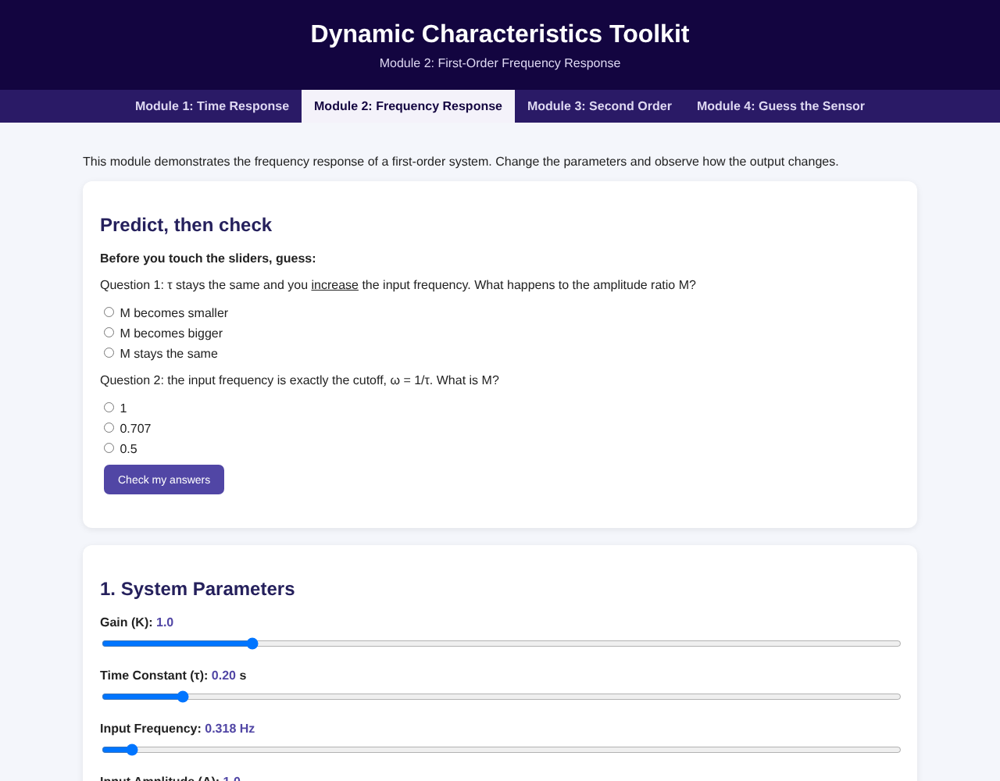
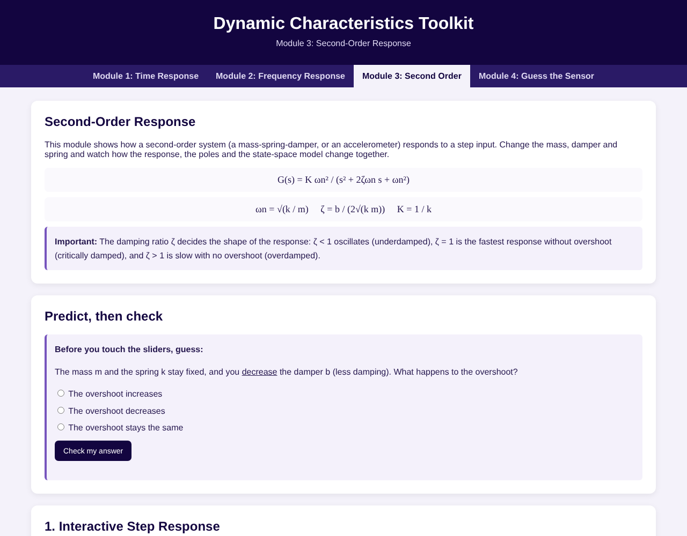
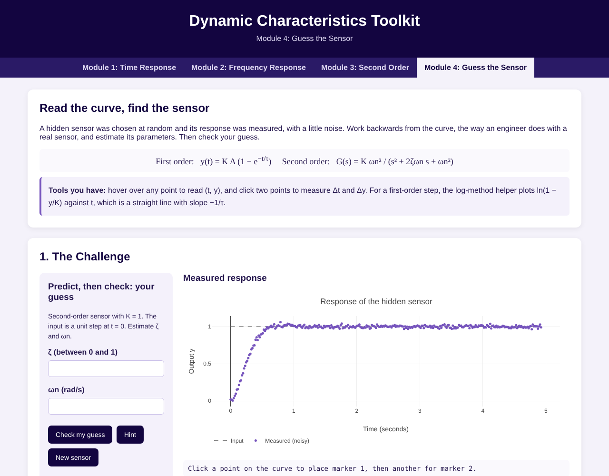

# Dynamic Characteristics Toolkit

**ENCS4380 Interfacing Techniques – Homework 1, Birzeit University**

An interactive web toolkit that shows how real sensors respond over time. Move the sliders and the plots redraw instantly, so you can see what the time constant, the damping ratio and the natural frequency actually do to a sensor's output.

The site is a static page on GitHub Pages, written in HTML and JavaScript, with plots drawn by [Plotly.js](https://plotly.com/javascript/). It works on desktop and on phones, and needs no server or login.

## Live website

**https://rahaf202122.github.io/encs4380-dynamics_Rahaf_Samar_Yasmeen_Sewar/**

Module 1 – Time Response ==> https://rahaf202122.github.io/encs4380-dynamics_Rahaf_Samar_Yasmeen_Sewar/?fbclid=IwZXh0bgNhZW0CMTEAcGRvZgNzcnRjBmFwcF9pZA80Mzc2MjYzMTY5NzM3ODgAAR8HA7STkq5iJBrEfKsQw8SM59DIRdoOx7SpCF6P5wjleP-1iA3gdfs3g1daSg_aem_I2ll4Cai1pM0qrEC0eeW5g

Module 2 – Frequency Response ==> [https://rahaf202122.github.io/encs4380-dynamics_Rahaf_Samar_Yasmeen_Sewar/module2.html](https://rahaf202122.github.io/encs4380-dynamics_Rahaf_Samar_Yasmeen_Sewar/module2.html)

Module 3 – Second-Order Response ==> https://rahaf202122.github.io/encs4380-dynamics_Rahaf_Samar_Yasmeen_Sewar/module3.html

Module 4 – Guess the Sensor ==> https://rahaf202122.github.io/encs4380-dynamics_Rahaf_Samar_Yasmeen_Sewar/module4.html

A navigation bar at the top of every page moves between the four modules.

## Team

| Member | Module | Files |
|---|---|---|
| Samar | Module 1 – First-Order Time Response | `index.html`, `module1.js` |
| Rahaf | Module 2 – First-Order Frequency Response | `module2.html`, `module2.js` |
| Sewar | Module 3 – Second-Order Response | `module3.html`, `module3.js` |
| Yasmeen | Module 4 – Guess the Sensor | `module4.html`, `module4.js` |

Each module has its own GitHub Issue, assigned to its owner.

## Modules

### Module 1 – First-Order Time Response (thermometer)

Model: τ·dy/dt + y = K·x, G(s) = K / (τs + 1)

- Sliders for K, τ and the input size, with a step or ramp input.
- Step: the 63.2% point at t = τ and the 95% point at t = 3τ are marked on the curve.
- Ramp: shows the time lag (= τ) and the steady-state error (= K·R·τ).
- Log method: ln of the error fraction against t is a straight line with slope −1/τ, and τ is read back from the slope.
- Lecture example button: a thermometer moved from 20 °C air into 80 °C tea (τ = 10 s).

### Module 2 – First-Order Frequency Response

Model: M = 1 / √(1 + (ωτ)²), φ = −tan⁻¹(ωτ)

- Sliders for K, τ, input frequency and input amplitude.
- Input and output sine waves on one plot.
- Amplitude ratio, phase lag, dynamic error δ = M − 1 and the cutoff frequency, all updated live.
- Bode magnitude and phase plots, with the cutoff at ω = 1/τ marked (M = 0.707, φ = −45°).

### Module 3 – Second-Order Response (mass-spring-damper)

Model: G(s) = K·ωn² / (s² + 2ζωn·s + ωn²), with ωn = √(k/m), ζ = b / (2√(km)), K = 1/k

- Sliders for mass m, damper b, spring k and the step force.
- Buttons for the underdamped (ζ = 0.5), critically damped (ζ = 1) and overdamped (ζ = 1.5) cases.
- Rise time, peak time, overshoot and settling time, read live off the plotted curve and marked on it.
- Poles in the s-plane.
- State-space panel: the A, B and C matrices update live, the eigenvalues of A are drawn next to the poles (they are the same numbers), and the phase plane shows the path of (x₁, x₂), which spirals when underdamped and does not when overdamped. The path is computed with an RK4 solver of the state equations.

### Module 4 – Guess the Sensor

- The page picks a hidden random sensor: first order (step or sine input) or second order (step input), with some noise added.
- The user estimates τ (and K), or ζ and ωn, using the methods from Modules 1–3. Clicking two points on the curve measures Δt and Δy, and a log-method helper is available for first-order steps.
- Hints on request.
- The page reveals the true values, overlays the true curve on the guess and scores it: within 10% gets full marks.
- A "New sensor" button starts another round, and a running score is kept for the session.

## Predict, then check

Every module has a "Predict, then check" box, so the user guesses what will happen before moving a slider:

- Module 1: the question uses the current slider values (for example, "what will the sensor read at t = τ?"), and the answer is checked against the formula.
- Module 2: what happens to M when the frequency goes up, and what M is at the cutoff.
- Module 3: what happens to the overshoot when the damping b goes down.
- Module 4: the whole module is a predict-then-check game.

## Validation checks

All six checks from the lecture slides are shown on the pages, each with the expected value, our value, and pass or fail. They run on their own and do not depend on the slider positions.

| # | Check | Expected | Our value | Result | Page |
|---|---|---|---|---|---|
| 1 | First-order step: y(τ)/KA and y(3τ)/KA | 0.632 and 0.950 | 0.6321 and 0.9502 | PASS | Module 1 |
| 2 | τ = 0.2 s, input sin 2t: amplitude ratio and phase lag | 0.93 and 21.8° | 0.9285 and 21.80° | PASS | Module 2 |
| 3 | Up to 100 Hz with at most 5% dynamic error: τmax and phase lag at 50 Hz | ≈ 0.52 ms and 9.3° | 0.523 ms and 9.33° | PASS | Module 2 |
| 4 | Second order, ζ = 0.5: overshoot | 16.3% | 16.30% | PASS | Module 3 |
| 5 | Second order, ζ = 1: overshoot | 0% | 0.00% | PASS | Module 3 |
| 6 | m = 1, b = 2, k = 4: eigenvalues of A, equal to the poles | −1 ± j1.732, equal | −1.000 ± j1.732, equal | PASS | Module 3 |

## Files

| File | What it contains |
|---|---|
| `index.html`, `module1.js` | Module 1 (the home page of the site) |
| `module2.html`, `module2.js` | Module 2 |
| `module3.html`, `module3.js` | Module 3 |
| `module4.html`, `module4.js` | Module 4 |
| `screenshots/` | The screenshots used in this README |

To run it locally, download the repository and open `index.html` in a browser (an internet connection is needed to load Plotly).

## Use of AI tools

We used Claude (an AI assistant by Anthropic) to help with this project:

- Explaining the homework requirements and the lecture formulas.
- Writing and reviewing parts of the JavaScript code, such as the plotting code, the navigation bar between the modules.
- Finding and fixing bugs.
- Writing this README.

All formulas come from the lecture slides, and every member reviewed the code of their own module and can explain it.

## Homework 2 — MARAI Control Toolkit

Homework 2 extends the same site with a PID control section. The home page (index.html) opens both toolkits: Homework 1 (Module 1 is now homework1.html) and Homework 2 (the Control section, starting at p1.html).

**Live website:** https://rahaf202122.github.io/encs4380-dynamics_Rahaf_Samar_Yasmeen_Sewar/

| Section | Entry | Owner | Features |
| --- | --- | --- | --- |
| P1 | p1.html | Sewar | First/second-order plants, filtered measurement derivative, actuator limits, metrics, three validation rows |
| P2 | p2.html | Rahaf | True and measured outputs, sensor lag, command plot, prediction, unstable example |
| P3 | p3.html | Samar | Sampled PID, sample-and-hold command, anti-windup, overshoot against Ts chart, live Arduino code and copy |
| P4 | p4.html | Yasmeen | Hidden random second-order plant, three pass/fail checks, score |
| My system | system.html | All four members | N20 drive motor model with sources, PI pole matching, 0–100% PWM simulation, check with τ halved and doubled, ESP32 code |
| Bonus | bonus.html | All four members | State feedback/pole placement and Ziegler–Nichols ultimate-gain experiment |

Each Homework 2 module has its own GitHub Issue, assigned to its owner. The Homework 1 ownership table above is unchanged.

### Numerical methods and metric definitions

P1 and P4 reuse sim.js and its RK4 integrator. P2 uses forward Euler with a step chosen to resolve the sensor and plant dynamics. P3 samples at k*Ts and integrates the held-input plant using RK4 substeps. State feedback uses RK4 on position and velocity. Ziegler–Nichols uses sim.js with the additional three-lag demonstration plant.

P1 retains its final-output-based rise, overshoot and settling definitions, documented on its page. New labs report overshoot and settling relative to the setpoint. A quiet final window is evidence of approximate convergence within the chosen run, not a mathematical proof of asymptotic convergence. Extend the run when diagnosing slow responses. P4 permits at most 1% steady error as its numerical interpretation of zero error.

P1 validation was checked with K=tau=1: Kp=9 gives 10% error and a 10–90% rise around 0.2197 s. Kp=Ki=1 gives characteristic wn=zeta=1 and negligible final step error. At the bonus model's Ku=12.6, measured peak period was approximately 1.4056 s versus theoretical 1.4050 s.

### My system: where the numbers come from

All motor numbers are taken from the datasheets of our parts (links on the page).

The plant is one Micromouse wheel: an N20 6 V 530 rpm gear motor with magnetic encoder (Roboticx ROBO-18014), driven by an L298N from an ESP32 and 2 × 18650 cells. Input is PWM duty in %, output is wheel speed in rpm.

- K ≈ 4.77 rpm per % PWM: 530 rpm at 6 V, scaled to the 5.4 V the motor gets at 100 % PWM (7.4 V battery minus about 2 V L298N drop, from the ST L298 datasheet).
- τ = 0.05 s: the datasheet does not give τ, so we use the usual value for an N20 gear motor with a light wheel. The page also checks the design with τ halved and doubled.

Spec: 0.6 ≤ ζ ≤ 0.8 (we use 0.75), overshoot ≤ 10 %, settling ≤ 0.3 s, zero steady-state error, PWM within 0–100 %. Final PI gains with ωn = 30 rad/s: Kp ≈ 0.262 %/rpm, Ki ≈ 9.43 %/(rpm·s). Simulated: 5.7 % overshoot, 0.17 s settling, peak PWM 87 %. The page generates ESP32 code for these gains with the encoder speed reading included.

### Additional AI assistance

ChatGPT/Codex assisted with the MARAI landing page, navigation, Homework 2 JavaScript, numerical verification, bonus experiments, Arduino templates and this update. The team must review the equations and code and be able to explain them during the demo. A public reference site was inspected for feature coverage and presentation inspiration. Claude (Anthropic) helped fix Module 2, add the navigation links, add the overshoot-against-Ts chart in P3, and build the My system page with the N20 motor model, the ESP32 code and this README section.
